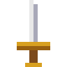

<p align="center">
  
</p>

<h1 align="center">zelda1-js</h1>

<p align="center">The Legend of Zelda (NES, 1986) reescrito en JavaScript para jugar en el navegador.</p>

---

Cada rutina del juego original se ha traducido una a una y se compara frame a frame con el juego real ejecutándose en un emulador. El objetivo es que sea idéntico: mismos gráficos, misma música, mismo comportamiento.

**Estado:** terminado. El juego completo funciona, con las dos misiones, todos los jefes y el final, y la imagen es idéntica píxel a píxel a la de la consola en todos los frames.

## Cómo jugar

No hace falta saber programar. Son cinco pasos y solo se hacen una vez.

### 1. Instala Node.js

Entra en [nodejs.org](https://nodejs.org), descarga la versión que pone **LTS** e instálala como cualquier otro programa, aceptando las opciones que vienen marcadas.

### 2. Descarga el juego

En esta página, pulsa el botón verde **Code** y luego **Download ZIP**. Descomprime el archivo donde quieras, por ejemplo en el Escritorio. Te quedará una carpeta llamada `zelda1-js-main`.

### 3. Pon tu ROM

El juego necesita tu copia de *The Legend of Zelda* para la NES, versión **USA (PRG0)**, en formato `.nes`. Este proyecto no la incluye.

Renómbrala a `zelda.nes` y métela en la carpeta `roms` que hay dentro de `zelda1-js-main`.

En Windows, si el archivo ya se ve como `zelda.nes`, escribe solo `zelda` al renombrarlo. Windows oculta la extensión y, si la vuelves a poner, el archivo acaba llamándose `zelda.nes.nes`.

### 4. Abre una terminal en la carpeta

- **Mac:** abre la aplicación **Terminal** (búscala con Cmd + Espacio). Escribe `cd` seguido de un espacio, arrastra la carpeta `zelda1-js-main` a la ventana y pulsa Enter.
- **Windows:** abre la carpeta `zelda1-js-main`, haz clic en la barra de direcciones de arriba, escribe `cmd` y pulsa Enter.

### 5. Arranca el juego

Escribe esto en la terminal y pulsa Enter:

```
npm start
```

El navegador se abrirá solo con el juego. Pulsa cualquier tecla para que empiece a sonar la música.

Para cerrar el juego, cierra la terminal. Para volver a jugar otro día, repite solo los pasos 4 y 5.

## Controles

| Teclado | Mando de NES |
|---|---|
| Flechas | Cruceta |
| X | A |
| Z | B |
| Enter | Start |
| Espacio | Select |

También funciona con un mando conectado al ordenador.

**Para empezar una partida:** en el menú pulsa Espacio hasta llegar a *Register your name* y pulsa Enter. Elige las letras con las flechas y escríbelas con X. Pulsa Espacio hasta llegar a *End* y luego Enter. Ya puedes elegir tu partida y pulsar Start.

## Partidas guardadas

Se guardan solas en el navegador, igual que en el cartucho original. Juega siempre desde el mismo navegador para no perderlas.

## Jugar en Android

También hay una versión para el móvil (probada pensando en un Samsung Galaxy S26 Ultra, pero vale para cualquier Android 8 o más nuevo). Es el mismo juego, con controles táctiles en la pantalla.

### 1. Prepara la app

Haz antes los pasos 1 a 4 de arriba. Además necesitas tener instalado [Android Studio](https://developer.android.com/studio) (solo para que el ordenador sepa crear apps de Android; no hace falta abrirlo después). Luego escribe en la terminal:

```
npm run android:build
```

Tarda un poco la primera vez. Al terminar tendrás la app en la carpeta `dist`, con el nombre `zelda1-js.apk`.

La app lleva **tu ROM dentro**: se coge de `roms/zelda.nes` (la que pusiste en los pasos de arriba), así que en el móvil no tendrás que buscarla ni elegirla. Tiene que ser la versión **USA (PRG0)**; si falta o es otra, `npm run android:build` se para y te dice qué pasa.

> **Importante:** como lleva el juego dentro, ese `zelda1-js.apk` es **solo para ti**. No lo compartas, no se lo pases a nadie y no lo subas a ningún sitio (ni a la nube, ni a webs, ni a GitHub). Tu ROM tampoco se sube nunca a este repositorio: se queda en tu ordenador.

### 2. Pásala al móvil

**La forma más fácil:** conecta el móvil al ordenador con el cable USB. En el móvil, activa las *Opciones de desarrollador* (en Ajustes, Información del teléfono, Información de software, toca siete veces *Número de compilación*) y dentro de ellas activa *Depuración USB*. Acepta el aviso que sale en el móvil y escribe:

```
npm run android:install
```

**Sin la depuración USB:** con el móvil conectado por cable, copia el archivo `dist/zelda1-js.apk` a la carpeta *Download* del móvil (como harías con una foto) y ábrelo desde la app *Mis archivos*. El móvil te pedirá permiso para *instalar apps desconocidas*: acéptalo solo para esa app. No te lo mandes por correo ni lo subas a la nube: lleva el juego dentro.

Para actualizarla más adelante, repite lo mismo: tus partidas se conservan.

Al abrir **Zelda 1 JS** el juego empieza directamente.

### Controles en el móvil

- **Cruceta** a la izquierda: puedes deslizar el dedo para cambiar de dirección sin levantarlo, también en diagonal.
- **B y A** a la derecha. Si pones el dedo entre los dos, pulsas los dos a la vez.
- **SELECT y START** abajo, en el centro.
- El botón **Atrás** del móvil (o el botón ≡ de arriba a la derecha) pausa el juego y abre un menú para continuar, quitar la vibración, cambiar el tamaño de la imagen o salir.
- Si conectas un **mando** por Bluetooth o USB, funciona directamente y los controles de la pantalla se esconden. Vuelven a salir en cuanto tocas la pantalla.

Las partidas se guardan solas dentro de la app, como en el cartucho. No se pierden al cerrarla ni al reiniciar el móvil, pero sí si desinstalas la app.

---

<sub>The Legend of Zelda es una marca de Nintendo. Proyecto de fans sin ánimo de lucro y sin relación con Nintendo. Este repositorio no contiene ningún dato del juego original. El código se publica bajo la licencia [GPL-3.0](LICENSE); la parte que dibuja la imagen como la consola real sigue el funcionamiento del emulador [Mesen2](https://github.com/SourMesen/Mesen2), también GPL-3.0.</sub>
